<p align="center">
  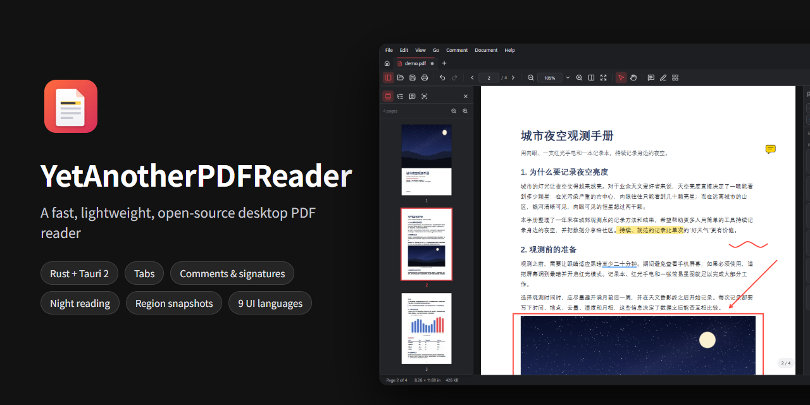
</p>

<h1 align="center">YetAnotherPDFReader</h1>

<p align="center">
  <b>A fast, lightweight, open-source PDF reader for the desktop</b><br>
  Tabs · comments &amp; signatures · page organizer &amp; merging · watermarks &amp; passwords · offline OCR · night reading · region snapshots — in a ~15 MB installer that works fully offline, no account needed.
</p>

<div align="center">

[](https://github.com/AlexEisie/YetAnotherPDFReader/releases/latest)
[](https://github.com/AlexEisie/YetAnotherPDFReader/releases)
[](LICENSE)
[](#-download)
[](https://www.rust-lang.org/)
[](https://tauri.app/)
[](https://github.com/AlexEisie/YetAnotherPDFReader/stargazers)

[简体中文](README.md) · **English**

</div>

<p align="center">
  <a href="#-download">Download</a> ·
  <a href="#-why-yapr">Why YAPR</a> ·
  <a href="#-screenshots">Screenshots</a> ·
  <a href="#-features">Features</a> ·
  <a href="#-comparison">Comparison</a> ·
  <a href="#-keyboard-shortcuts">Shortcuts</a> ·
  <a href="#-architecture">Architecture</a> ·
  <a href="#-building-from-source">Build</a> ·
  <a href="CHANGELOG.md#english">Changelog</a>
</p>

<p align="center">
  <a href="https://github.com/AlexEisie/YetAnotherPDFReader/releases/latest"></a>
</p>

---

## 📥 Download

> [!TIP]
> **New in v0.4.0**: an in-app user guide (`F1`), update checks (optionally daily / weekly, off by default), and a short "what's new" after each update. v0.3.0 added offline text recognition (OCR); v0.2.0 added the page organizer, merging and splitting, watermarks, password protection and Linux builds. See the [changelog](CHANGELOG.md#english).

Get the latest version from [Releases](https://github.com/AlexEisie/YetAnotherPDFReader/releases/latest) (from v0.4.2 on, file names include the platform and architecture):

| Package | File | Notes |
| --- | --- | --- |
| **Installer (recommended)** | `YetAnotherPDFReader_x.y.z_windows_x64-setup.exe` | Per-user install, **no administrator rights needed**; registers the `.pdf` file association; setup in English, 简体中文, 繁體中文 and 日本語 |
| MSI package | `YetAnotherPDFReader_x.y.z_windows_x64.msi` | For managed deployment (Group Policy, Intune, …) |
| **Portable** | `YetAnotherPDFReader_x.y.z_windows_x64_portable.zip` | Unzip and run. Settings, recent files, logs and caches stay in a `data` folder next to the program, so it can live on a USB stick |
| 🐧 **Linux deb** | `YetAnotherPDFReader_x.y.z_linux_x64.deb` | Debian, Ubuntu, Linux Mint, …: `sudo apt install ./YetAnotherPDFReader_x.y.z_linux_x64.deb` |
| 🐧 Linux rpm | `YetAnotherPDFReader_x.y.z_linux_x64.rpm` | Fedora, openSUSE, …: `sudo dnf install ./YetAnotherPDFReader_x.y.z_linux_x64.rpm` |
| 🐧 AppImage | `YetAnotherPDFReader_x.y.z_linux_x64.AppImage` | Any distribution: `chmod +x` and run |
| 🍎 **macOS (Apple silicon)** | `YetAnotherPDFReader_x.y.z_macos_arm64.dmg` | M1 and newer Macs: open it and drag the app to *Applications* |
| 🍎 macOS (Intel) | `YetAnotherPDFReader_x.y.z_macos_x64.dmg` | Intel Macs (from the next release) |
| 🐧 Linux ARM64 | `YetAnotherPDFReader_x.y.z_linux_arm64.deb`<br>`YetAnotherPDFReader_x.y.z_linux_arm64.rpm`<br>`YetAnotherPDFReader_x.y.z_linux_arm64.AppImage` | ARM64 devices (64-bit Raspberry Pi 4/5 systems, ARM servers and laptops, …), used as above (from the next release) |

**Requirements**: Windows 10 / 11 (x64); macOS 13.4 (Ventura) or later; or Linux x86_64 / ARM64 with glibc 2.35+ (Ubuntu 22.04, Debian 12, Fedora 36 or newer) and WebKitGTK 4.1 — the deb / rpm packages pull in their dependencies. On Windows, the app uses the Microsoft Edge WebView2 runtime that ships with Windows 11 and up-to-date Windows 10. If it is missing, the installer downloads it automatically; for the portable version, install the [WebView2 runtime](https://developer.microsoft.com/microsoft-edge/webview2/) first.

> [!NOTE]
> The binaries are not code-signed yet. If SmartScreen warns on first launch, click "More info" → "Run anyway".
>
> The macOS app is not notarized by Apple, so macOS blocks the first launch: open *System Settings ▸ Privacy & Security* and click *Open Anyway*. If macOS says the app "is damaged", run `xattr -dr com.apple.quarantine /Applications/YetAnotherPDFReader.app` in Terminal and open it again. SHA-256 checksums of every file are listed in the release notes.

---

## ✨ Why YAPR

| | Highlight | Details |
| :-: | --- | --- |
| 🪶 | **Really lightweight** | ~15 MB installer (about 10 MB of it is the offline OCR engine), quick start-up, small memory footprint. Files above a configurable size are read from disk in 1 MB ranges, so even documents of several hundred MB open instantly |
| 🔒 | **Offline and private** | No account, no ads, no telemetry. The only network access is the optional update check (GitHub only, off by default). Web links in documents ask before opening by default |
| 🛡️ | **Safe saving** | Changes are written as an *incremental update*: the original bytes are kept intact, so **existing digital signatures stay valid**. Files are written to a temporary file and atomically swapped in, with an optional `.bak` copy; unsaved comments can be recovered after a crash |
| ✍️ | **Full commenting, free** | Highlights, sticky notes, shapes, stamps, signatures and text boxes — and **comments already in the file can be edited too** |
| 🗂️ | **Page organizer, free** | Select, drag to reorder, rotate, flip, duplicate, replace and delete in a large thumbnail grid; **combine several PDFs and pictures at once**, or drop them from Explorer straight between pages; split documents by page count or ranges; text or picture watermarks. Every step can be undone |
| 🔎 | **Offline OCR** | PaddleOCR PP-OCRv6 recognises Chinese and English accurately and fast (~0.2 s per page), entirely on your computer. Recognise a region and copy its text, or make a whole scan searchable and selectable without changing how it looks |
| 🔐 | **Password protection** | AES-256 encryption with an open password and / or restricted printing, copying and editing; removing protection takes one step |
| 🌙 | **Comfortable night reading** | Dark (inverted), **night (dark pages, images keep their natural colours)**, sepia, eye-care green and custom colours; can follow the system dark theme, and sidebar thumbnails are dimmed to match |
| 📸 | **Sharp region snapshots** | Drag over any part of a page: it is re-rendered from the PDF (up to 600 DPI) and copied straight to the clipboard — not a blurry screen grab. Snapshot mode ends after each capture |
| ⌨️ | **Built for speed** | Command palette (Ctrl+Shift+P), fully customisable shortcuts, searchable layered settings, 9 UI languages |
| 🧩 | **Open source** | MIT licensed. The PDF writing core is a standalone Rust crate covered by unit tests and end-to-end tests that drive the real app |

---

## 📸 Screenshots

<p align="center">
  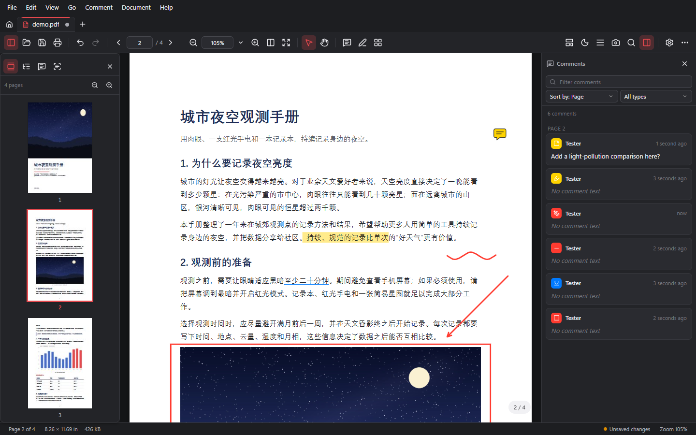<br>
  <sub>Main window (dark theme): page thumbnails on the left, the comment list on the right, with highlight, underline, sticky note, ink, arrow and rectangle comments on the page</sub>
</p>

<table>
  <tr>
    <td width="50%">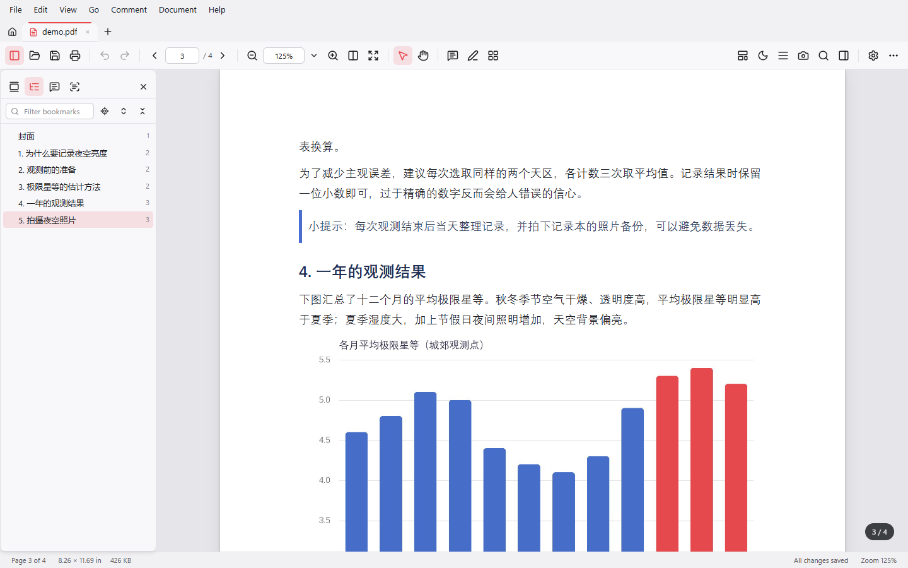<br><sub>Light theme with the bookmarks panel</sub></td>
    <td width="50%">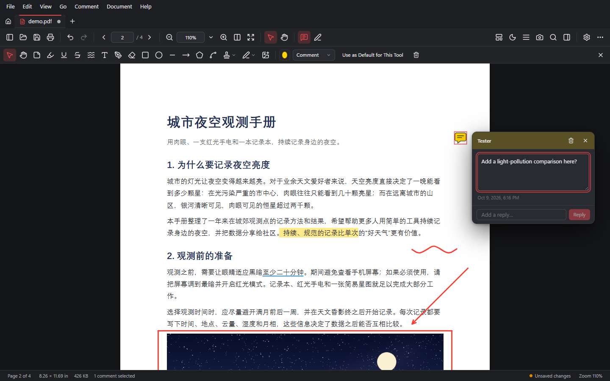<br><sub>Comment toolbar, sticky note and replies</sub></td>
  </tr>
  <tr>
    <td width="50%">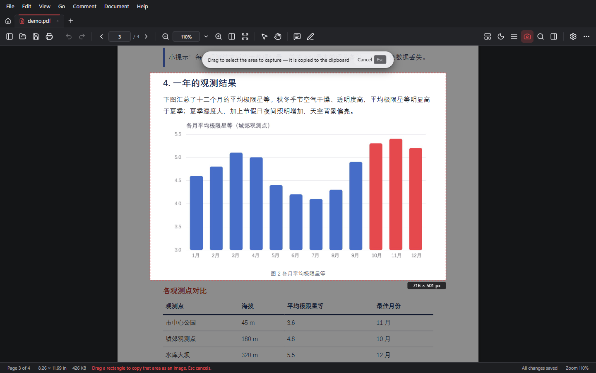<br><sub>Region snapshot: everything outside the selection is dimmed, and the output size is shown</sub></td>
    <td width="50%">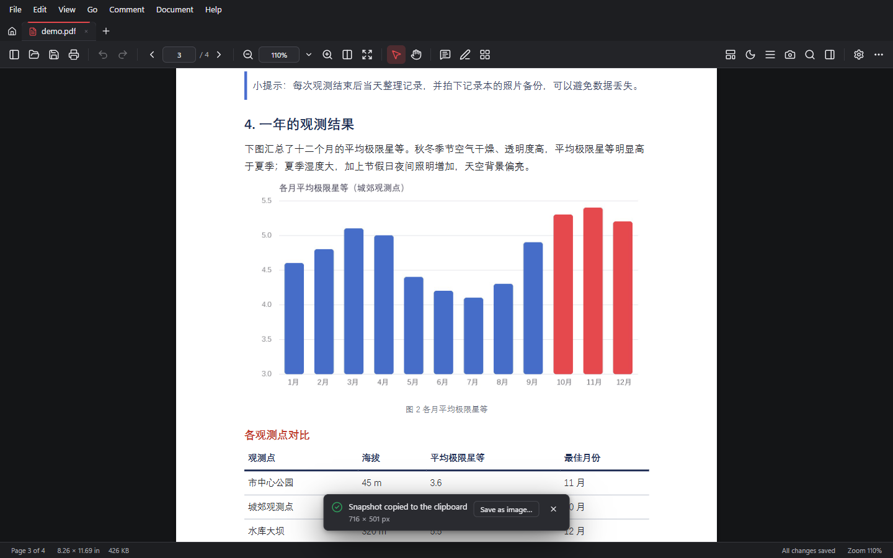<br><sub>Release to copy it to the clipboard; snapshot mode ends automatically, and "Save as image…" writes a PNG</sub></td>
  </tr>
  <tr>
    <td width="50%">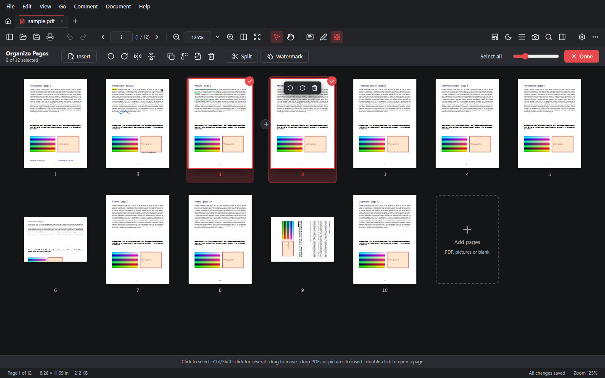<br><sub>Page organizer: multi-select, drag to reorder, hover actions, drop files to insert</sub></td>
    <td width="50%">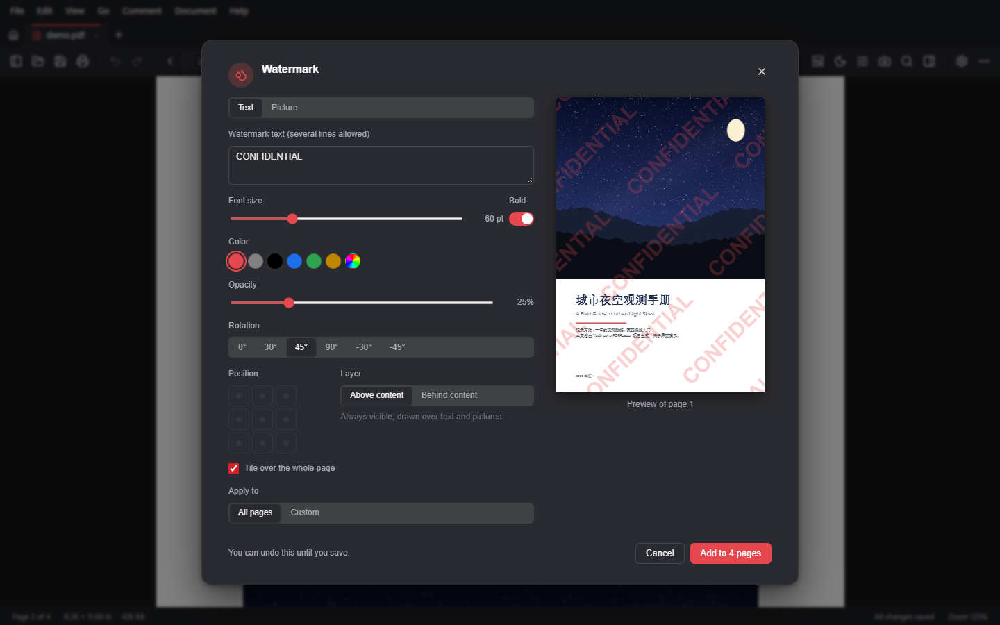<br><sub>Watermarks: text or picture, nine positions or tiled, live preview</sub></td>
  </tr>
  <tr>
    <td width="50%">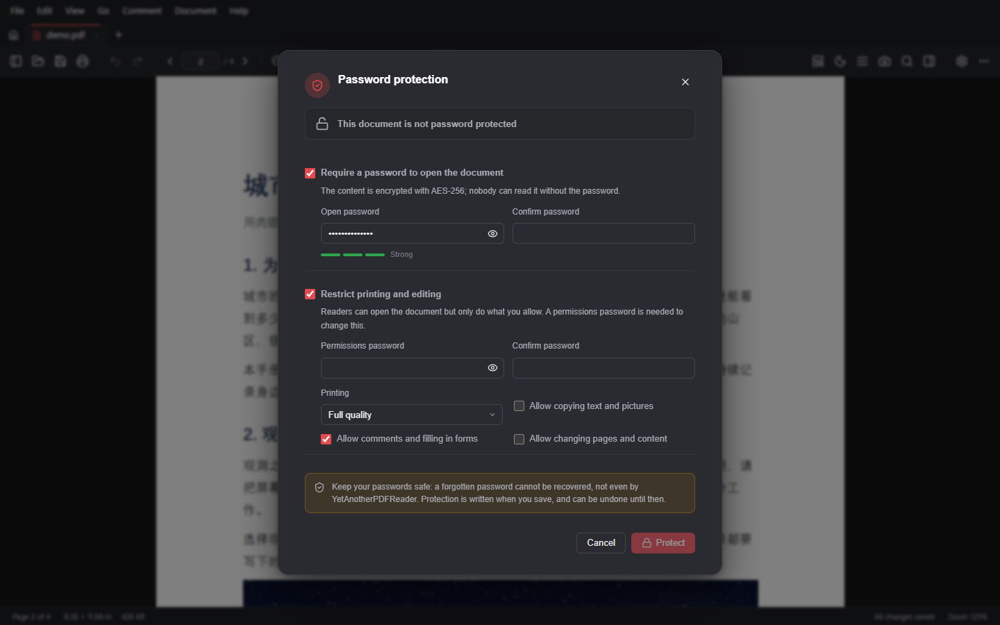<br><sub>Password protection: open password, permissions and a strength meter</sub></td>
    <td width="50%">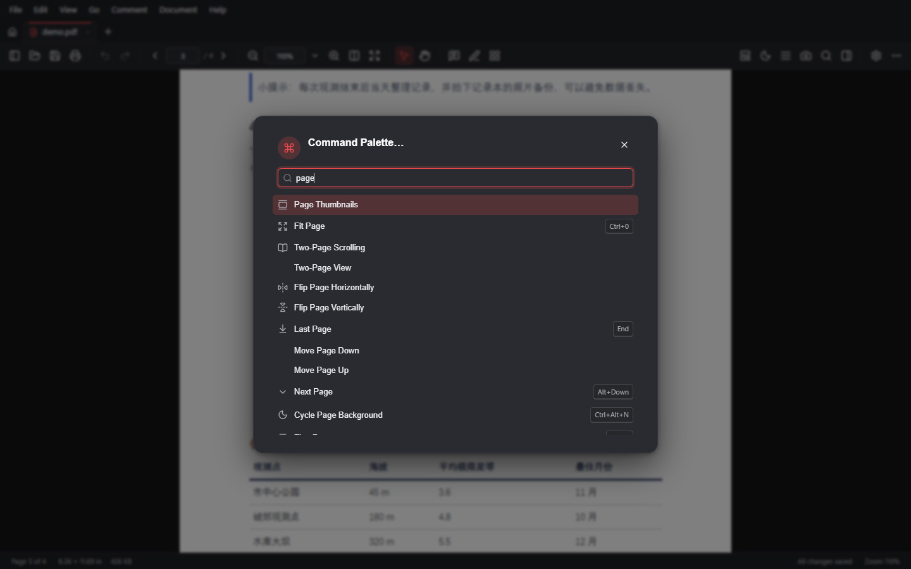<br><sub>Command palette: find and run any command</sub></td>
  </tr>
  <tr>
    <td width="50%">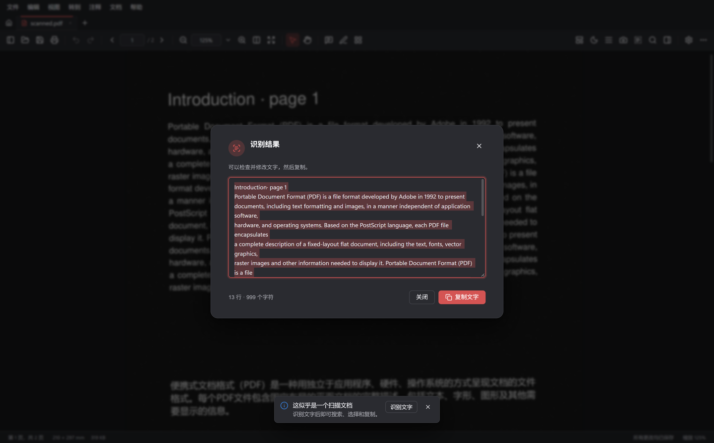<br><sub>Recognize text in a region of a scanned page, then edit and copy it (Chinese UI)</sub></td>
    <td width="50%">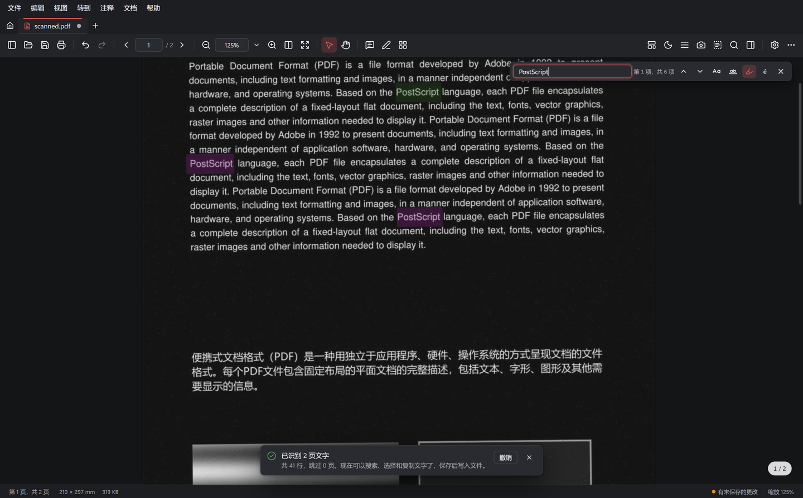<br><sub>After OCR, scans can be searched — highlights line up with the picture (Chinese UI)</sub></td>
  </tr>
  <tr>
    <td width="50%">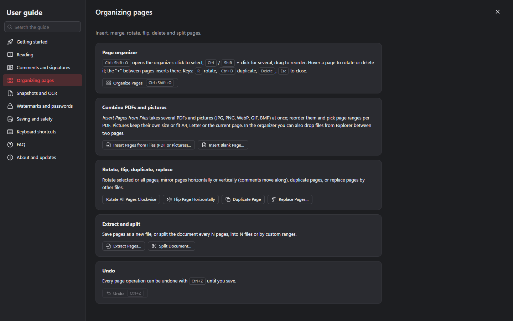<br><sub>User guide (<code>F1</code>): features by topic, with buttons that open them</sub></td>
    <td width="50%">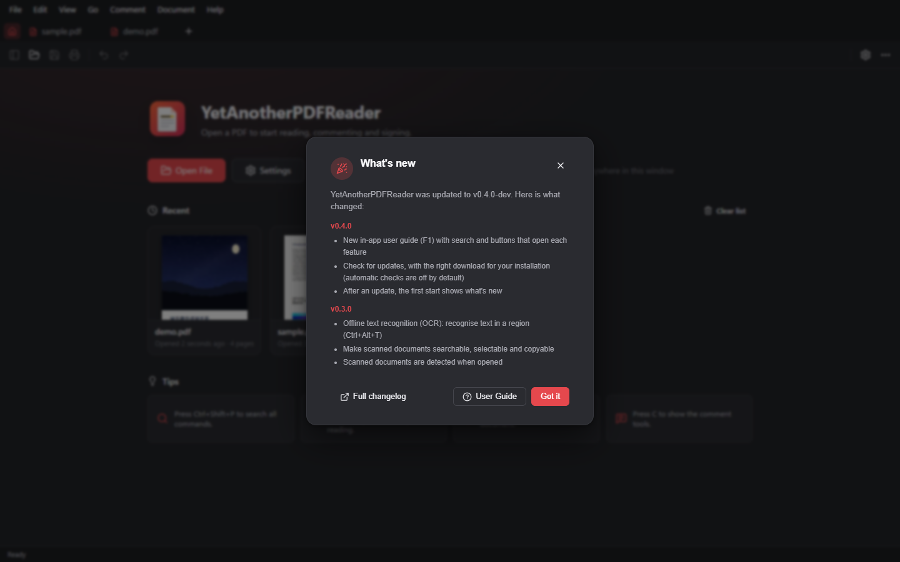<br><sub>After an update, the first start lists what changed in each new version</sub></td>
  </tr>
</table>

**Page colour modes** — the same page in all five modes. Note how *night* darkens the page but keeps the picture in its natural colours.

<p align="center">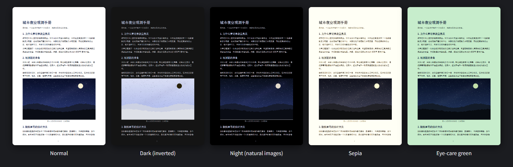</p>

<p align="center">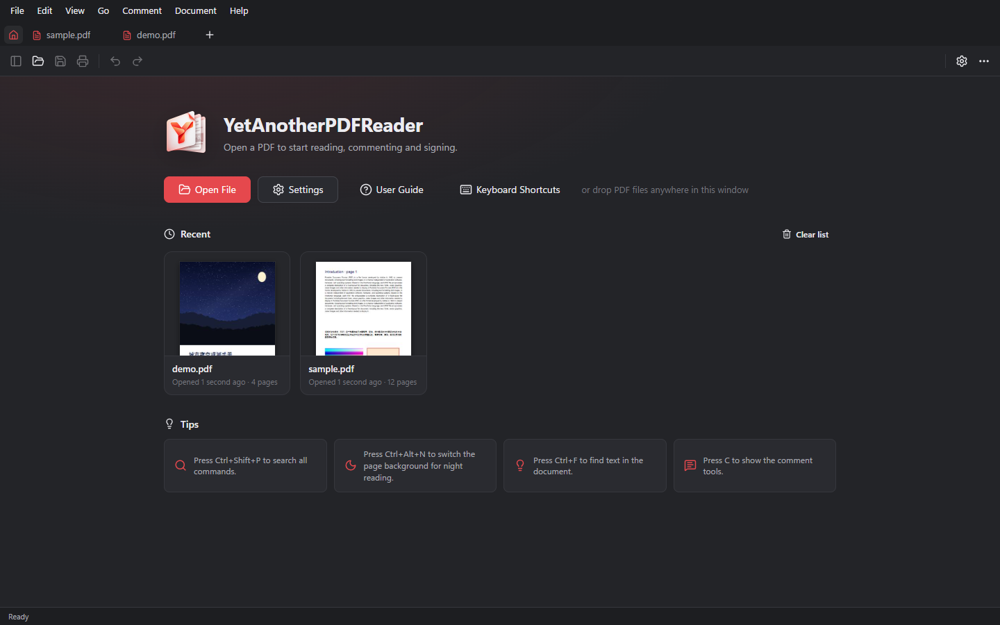<br><sub>Start page with cover thumbnails of recent documents</sub></p>

> The demo document is generated by [`scripts/make-demo-pdf.py`](scripts/make-demo-pdf.py) and the screenshots are taken automatically by [`scripts/readme-shots.mjs`](scripts/readme-shots.mjs).

---

## 📚 Features

### Reading

| Feature | Details |
| --- | --- |
| **Tabs** | Drag to reorder, middle-click to close, reopen closed tabs, restore the last session; opening a file that is already open switches to its tab |
| **Page layouts** | Single page, continuous, two-page (with or without cover), horizontal, wrapped |
| **Zoom** | Presets, fit page, fit width, actual size; Ctrl+wheel and touchpad pinch zoom around the pointer; rotate the view |
| **Sidebar** | Virtualised page thumbnails (drag to reorder pages), bookmarks (filter, expand / collapse, follows the current position), comment list, attachments, layers, full-text search |
| **Find** | Match case, whole words, diacritics, highlight all; go to a page number or page label; back / forward history |
| **Links and forms** | Internal destinations, external links with an optional confirmation, interactive forms |
| **Focus** | Read mode, full screen, presentation mode (transitions, auto-advance, click to advance), auto scroll |
| **Page colours** | Normal, dark, night (images keep their colours), sepia, eye-care green and custom text / background colours; can follow the dark theme |
| **Region snapshot** | Ctrl+Alt+S or the 📷 toolbar button. Screen resolution or 150 / 300 / 600 DPI, with or without comments and page colours |
| **More** | Read Out Loud (system voices); printing with page ranges and quality; export pages as images or text; document properties (edit title, author, …; view security and fonts) |

### Commenting and editing

| Feature | Details |
| --- | --- |
| **Text markup** | Highlight, underline, strikethrough, squiggly — with a floating toolbar for selected text |
| **Notes and discussion** | Sticky notes with reply threads and review status; text boxes |
| **Drawing** | Freehand ink (smoothed, nearby strokes merged), eraser, rectangles, ellipses, lines, arrows, polygons, polylines |
| **Stamps and signatures** | Standard stamps, dynamic stamps with name and date, custom and image stamps; drawn, typed or image signatures saved for reuse |
| **Editing comments** | Select, move, resize, edit vertices; change colour, opacity, line width, fonts and line endings; copy & paste, lock, set as the tool default. **Works for new comments and for comments already stored in the file** |
| **Page organisation** | Rotate, delete, insert blank pages, insert pages from another PDF, reorder, extract to a new file |
| **Undo and saving** | Undo / redo for everything, page operations included; unsaved-changes tracking; Save, Save As, Revert; crash recovery; optional backup copies |

### Page editing and protection

| Feature | Details |
| --- | --- |
| **Page organizer** (`Ctrl+Shift+O`) | Large, resizable thumbnail grid; click, Ctrl / Shift + click and arrow keys to select; drag to reorder; hover buttons to rotate or delete, and a "+" between pages to insert there; context menu and shortcuts (`R` rotate, `Ctrl+D` duplicate, `Delete`) |
| **Combine files** | Pick several PDFs and pictures (JPG, PNG, WebP, GIF, BMP), reorder them and choose page ranges per PDF; pictures keep their own size or fit A4, Letter or the current page with a margin, in matching orientation. JPEG photos are embedded unchanged and turned upright (EXIF). Or drop files from Explorer between two pages |
| **Rotate and flip** | Rotate selected or all pages clockwise, counterclockwise or 180°; mirror pages horizontally or vertically, with comments moved along |
| **Duplicate, replace, delete, extract** | Duplicate pages (with comments), replace pages by other PDFs or pictures, delete, extract to a new file |
| **Split documents** | Every N pages, into N files or custom ranges, with a preview of the file names and a choice of folder |
| **Watermarks** | Text (CJK, several lines, bold, colour) or picture; opacity, angle, nine positions or tiled, above or behind the content; live preview and remembered settings |
| **Text recognition (OCR)** | *Recognize Text in Region* (`Ctrl+Alt+T`): drag over text, then check, edit and copy the result. *Recognize Text (OCR)…*: add an invisible text layer to the whole document or chosen pages so scans can be searched, selected and copied; pages with text are skipped by default, with progress and cancel. Scanned documents are detected on opening. Research and benchmark: [docs/ocr.md](docs/ocr.md#english) |
| **Password protection** | AES-256; open password and permissions password (printing, copying, comments, editing); strength meter; unlock restrictions for the session with the permissions password; remove protection in one step |

### Quality of life

- Light, dark or system theme; accent colour, density, text size and animations
- **9 UI languages**: English, 简体中文, 繁體中文, 日本語, 한국어, Deutsch, Français, Español, Русский
- Layered settings with search, per-option reset and import / export
- Fully customisable keyboard shortcuts and a command palette
- **In-app user guide** (`F1`): features explained by topic, with search, "try it" buttons and the shortcuts currently in effect
- **Update check**: check from *Help ▸ Check for Updates* or automatically every day / week; picks the right package for how the app was installed, and a version can be skipped
- **What's new**: the first start after an update lists the main changes since the version you used before
- File association; single instance (files opened from Explorer go to the running window); drag & drop
- Notices when an open file is changed or deleted by another program

---

## 🆚 Comparison

A rough comparison with the **free editions** of popular Windows PDF readers, compiled by the author for orientation only. These apps change quickly — corrections via Issues are welcome.

| | **YAPR** | Adobe Acrobat Reader | Foxit PDF Reader | SumatraPDF |
| --- | :-: | :-: | :-: | :-: |
| Open source | ✅ MIT | ❌ | ❌ | ✅ GPLv3 |
| Installer size | **~15 MB** | hundreds of MB | ~100 MB | ~10 MB |
| No account, promotions or telemetry | ✅ | ❌ | ❌ | ✅ |
| Tabs | ✅ | ✅ | ✅ | ✅ |
| Full commenting (shapes, stamps, signatures) | ✅ | ✅ | ✅ | basic |
| Edit comments already in the file | ✅ | ✅ | ✅ | partial |
| Page organisation (insert, delete, reorder, extract) | ✅ free | paid edition | depends on edition | ❌ |
| Combine PDFs and pictures, split documents | ✅ free | paid edition | depends on edition | ❌ |
| Watermarks, add / remove passwords | ✅ free | paid edition | depends on edition | ❌ |
| Text recognition (OCR), searchable scans | ✅ free, offline | paid edition | paid edition | ❌ |
| Copy a page region to the clipboard | ✅ choose DPI | ✅ | ✅ | ✅ |
| Command palette | ✅ | ❌ | ❌ | ✅ |
| Portable version | ✅ | ❌ | ❌ | ✅ |

**In short**: if all you need is a minimal, very fast viewer, SumatraPDF is a great choice. If you want Acrobat-style commenting, page tools, watermarks and encryption without a multi-hundred-MB install, sign-ins and upsells, YAPR is built for you.

---

## ⚡ Keyboard shortcuts

| Action | Shortcut | Action | Shortcut |
| --- | --- | --- | --- |
| Open | `Ctrl+O` | Command palette | `Ctrl+Shift+P` / `Ctrl+K` |
| Save / Save As | `Ctrl+S` / `Ctrl+Shift+S` | Find | `Ctrl+F` |
| Print | `Ctrl+P` | Go to page | `Ctrl+G` |
| Undo / Redo | `Ctrl+Z` / `Ctrl+Y` | Fit page / Fit width | `Ctrl+0` / `Ctrl+2` |
| Close tab / Reopen closed | `Ctrl+W` / `Ctrl+Shift+T` | Zoom in / out | `Ctrl+=` / `Ctrl+-` |
| Next tab | `Ctrl+Tab` | Toggle sidebar | `F4` |
| Region snapshot | `Ctrl+Alt+S` | Cycle page colours | `Ctrl+Alt+N` |
| Comment toolbar | `C` | Select / Hand tool | `V` / `H` |
| Page organizer | `Ctrl+Shift+O` | Delete current page | `Ctrl+Shift+D` |
| Recognize text in region (OCR) | `Ctrl+Alt+T` | | |
| Read mode | `Ctrl+H` | Presentation | `F5` / `Ctrl+L` |
| Full screen | `F11` | Document properties | `Ctrl+D` |
| Settings | `Ctrl+,` | Shortcut list | `Ctrl+/` |
| User guide | `F1` | | |

Every shortcut can be changed in *Settings ▸ Keyboard shortcuts*. Hover a button in the comment toolbar to see its single-key shortcut.

---

## 🧱 Architecture

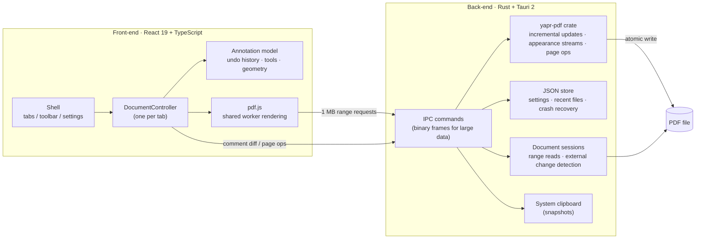

**Saving** — every save is computed as a diff against the original file and appended as an incremental update:

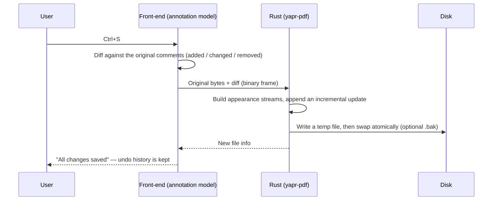

Design notes:

- **Rendering** is done by pdf.js in a single shared worker. Files above a configurable size are streamed from disk in 1 MB ranges; background tabs release their render caches after a delay.
- **Comments** live in an in-memory model. Comments stored in the file are read by the Rust core; when one is modified, the app hides pdf.js' rendering of it and draws its own.
- **Saving** is always a diff against the original bytes, written by Rust as an incremental update, so the original content and digital signatures stay intact.
- **Page operations** rebuild the document in Rust and keep the previous bytes, so they can be undone.
- **Snapshots** re-render the region from the PDF and hand the pixels to Rust, which writes them to the system clipboard — avoiding the WebView clipboard's user-activation limits.

<details>
<summary><b>Project layout</b></summary>

```
src/                     React + TypeScript front-end
  document/              DocumentController: pdf.js viewer, history, save pipeline, page colours,
                         print, presentation, read aloud, search, thumbnails, snapshots
  annotations/           annotation model, undo history, tools, geometry, DTOs, serialisation
  components/            UI (shell, viewer, annotation overlays, sidebar, dialogs, settings)
  commands/              command registry + keyboard shortcut handling
  settings/              settings model (validated), schema of the settings pages
  i18n/                  runtime + 9 locales
  pdf/                   pdf.js bootstrap (shared worker, range streaming)
src-tauri/               Tauri application shell (Rust)
  session.rs             open documents, byte-range reads, external change detection
  commands.rs            IPC commands (binary framing for large payloads)
  store.rs / fsutil.rs   crash-safe JSON store and atomic file writes
  portable.rs            portable mode
crates/yapr-pdf/         PDF writing core (Rust, no UI dependency, unit tested): comments, page
                         operations, pictures as pages, watermarks, AES-256 encryption
scripts/                 sample generators, end-to-end tests, UI smoke test, README screenshots
```

</details>

---

## 🔧 Building from source

**Prerequisites**: Rust (stable; MSVC toolchain on Windows), Node.js 22 or newer, WebView2 (included in Windows 10/11).

```bash
git clone https://github.com/AlexEisie/YetAnotherPDFReader.git
cd YetAnotherPDFReader
npm install

npm run tauri dev        # development (Rust back-end + Vite hot reload)
npm run tauri build      # release build: NSIS installer and MSI
```

**macOS**: with the Xcode command line tools installed, `npm run tauri build` makes the `.app` and `.dmg`; release builds come from GitHub Actions.

**Releases**: pushing a `vX.Y.Z` tag runs the [Release workflow](.github/workflows/release.yml), which tests, builds every Windows, macOS and Linux package and publishes the release.

**Linux packages**: run `bash scripts/build-linux.sh` on Linux or in WSL (Ubuntu 22.04 recommended) to build the deb, rpm and AppImage; the required packages are listed at the top of the script.

UI-only development in a browser, with a mocked back-end:

```bash
python scripts/make-sample-pdfs.py   # sample documents in dev/samples/ (needs PyMuPDF)
npm run dev                          # open http://localhost:5174
```

**Portable mode**: put `yapr.exe` in a folder together with an empty file named `portable` (or `portable.txt`). When the app finds it, all data goes into a `data` folder next to it.

### Tests

```bash
npm test                         # front-end unit tests (Vitest)
cargo test --workspace           # Rust unit tests (PDF core, store, IPC framing)
cargo clippy --all-targets       # lints
node scripts/e2e-tauri.mjs       # end-to-end: drives the real app, verifies the written PDF and the clipboard
npm run test:ui                  # UI smoke test with screenshots
npm run test:editing             # end-to-end: organizer, combining pictures and PDFs, watermarks, encryption
npm run test:ocr                 # end-to-end: scan suggestion, region and document OCR, find and save
npm run test:help                # end-to-end: user guide and update check (faked new release, skipping, network errors)
npm run test:release             # release build smoke test
```

---

## 📌 Roadmap

- [x] First Windows release (installer, MSI, portable)
- [ ] Code signing
- [x] In-app user guide and update check
- [x] Linux builds (deb, rpm, AppImage; x86_64 and ARM64)
- [x] macOS builds (Apple silicon and Intel)
- [x] Page organizer, merging and splitting, watermarks, password protection
- [x] Offline text recognition (OCR)
- [ ] Multi-page snapshots, editing page content

Ideas and bug reports are welcome in [Issues](https://github.com/AlexEisie/YetAnotherPDFReader/issues).

## 🤝 Contributing

Issues and pull requests are welcome. Before submitting code, please make sure `npm test`, `cargo test --workspace` and `cargo clippy --all-targets` pass. If you change UI text, update all 9 locale files in `src/i18n/locales/`.

## 📄 License

[MIT](LICENSE). Licences of third-party components (pdf.js, Tauri, React, lopdf, …) are listed in [THIRD-PARTY-NOTICES.md](THIRD-PARTY-NOTICES.md).

## 🙏 Acknowledgements

- [pdf.js](https://github.com/mozilla/pdf.js) — PDF rendering
- [PaddleOCR](https://github.com/PaddlePaddle/PaddleOCR), [ONNX Runtime](https://onnxruntime.ai/), [oar-ocr](https://github.com/GreatV/oar-ocr) — offline text recognition
- [Tauri](https://tauri.app/) — lightweight desktop framework
- [lopdf](https://github.com/J-F-Liu/lopdf) — PDF reading and writing in Rust
- [React](https://react.dev/), [Zustand](https://github.com/pmndrs/zustand), [Lucide](https://lucide.dev/), [arboard](https://github.com/1Password/arboard)

<p align="center">If YAPR is useful to you, a ⭐ star is much appreciated!</p>
