<p align="center">
  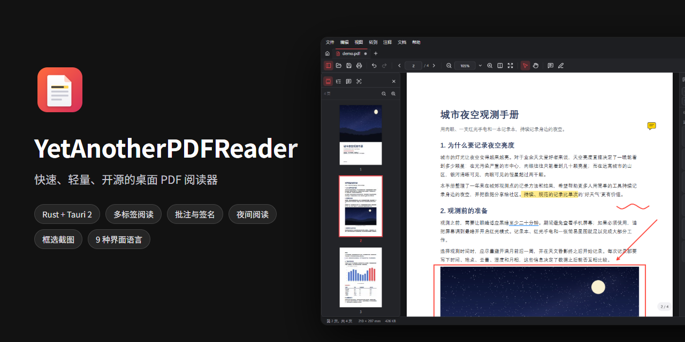
</p>

<h1 align="center">YetAnotherPDFReader</h1>

<p align="center">
  <b>快速、轻量、开源的桌面 PDF 阅读器</b><br>
  多标签阅读 · 批注与签名 · 页面整理 · 夜间阅读 · 框选截图 —— 安装包约 5 MB，完全离线，不需要账号。
</p>

<div align="center">

[](https://github.com/AlexEisie/YetAnotherPDFReader/releases/latest)
[](https://github.com/AlexEisie/YetAnotherPDFReader/releases)
[](LICENSE)
[](#-下载安装)
[](https://www.rust-lang.org/)
[](https://tauri.app/)
[](https://github.com/AlexEisie/YetAnotherPDFReader/stargazers)

**简体中文** · [English](README.en.md)

</div>

<p align="center">
  <a href="#-下载安装">下载安装</a> ·
  <a href="#-为什么选择-yapr">为什么选择 YAPR</a> ·
  <a href="#-界面预览">界面预览</a> ·
  <a href="#-功能一览">功能一览</a> ·
  <a href="#-与其他阅读器对比">对比</a> ·
  <a href="#-常用快捷键">快捷键</a> ·
  <a href="#-技术架构">技术架构</a> ·
  <a href="#-从源码构建">从源码构建</a>
</p>

<p align="center">
  <a href="https://github.com/AlexEisie/YetAnotherPDFReader/releases/latest"></a>
</p>

---

## 📥 下载安装

前往 [Releases](https://github.com/AlexEisie/YetAnotherPDFReader/releases/latest) 下载最新版本：

| 版本 | 文件 | 说明 |
| --- | --- | --- |
| **安装版（推荐）** | `YetAnotherPDFReader_x.y.z_x64-setup.exe` | 安装到当前用户，**不需要管理员权限**；会注册 `.pdf` 文件关联；安装界面支持简体中文、English、繁體中文和日本語 |
| MSI 安装包 | `YetAnotherPDFReader_x.y.z_x64_en-US.msi` | 适合企业批量部署（组策略、Intune 等） |
| **便携版** | `YetAnotherPDFReader_x.y.z_x64_portable.zip` | 解压即用。设置、最近文件、日志和缓存都保存在程序旁边的 `data` 文件夹里，可以放在 U 盘中随身携带 |

**系统要求**：Windows 10 / 11（x64）。程序使用系统中的 Microsoft Edge WebView2 运行时，Windows 11 和保持更新的 Windows 10 都已自带。如果系统中没有，安装版会自动下载安装；便携版请先手动安装 [WebView2 运行时](https://developer.microsoft.com/microsoft-edge/webview2/)。

> [!NOTE]
> 安装包暂未做代码签名。首次运行如果出现 SmartScreen 提示，点击「更多信息」→「仍要运行」即可。每个版本文件的 SHA-256 校验值都列在 Release 说明中。

---

## ✨ 为什么选择 YAPR

| | 特色 | 说明 |
| :-: | --- | --- |
| 🪶 | **非常轻量** | 安装包约 5 MB，启动快，内存占用小。超过设定大小的文件会按 1 MB 分块从磁盘读取，几百 MB 的文档也能马上打开 |
| 🔒 | **完全离线，保护隐私** | 不需要账号，没有广告和遥测，也没有任何联网代码。点击文档里的网页链接时，默认会先询问 |
| 🛡️ | **保存稳妥** | 修改以*增量更新*的方式写回 PDF：原始内容原样保留，**已有的数字签名不会失效**。写入时先写临时文件再原子替换，可选保留 `.bak` 备份；程序意外退出后，可以恢复未保存的批注 |
| ✍️ | **免费的完整批注和页面整理** | 高亮、便笺、图形、图章、签名、文本框一应俱全，**文件里原有的批注也能直接修改**。插入、删除、旋转、重排、提取页面同样免费，每一步都能撤销 |
| 🌙 | **舒适的夜间阅读** | 提供深色（反色）、**夜间（页面变暗，图片保持原色）**、棕褐、护眼绿和自定义配色，可以跟随系统深色主题，侧栏缩略图也会一起调暗 |
| 📸 | **清晰的框选截图** | 框选页面上任意区域，按 PDF 内容重新渲染（最高 600 DPI）后直接复制到剪贴板，不是模糊的屏幕截图；截完自动退出截图模式 |
| ⌨️ | **高效顺手** | 命令面板（Ctrl+Shift+P）、可完全自定义的快捷键、可搜索的分层设置页、9 种界面语言 |
| 🧩 | **开源，可审查** | MIT 协议。PDF 写入核心是独立的 Rust crate，有单元测试和驱动真实应用的端到端测试 |

---

## 📸 界面预览

<p align="center">
  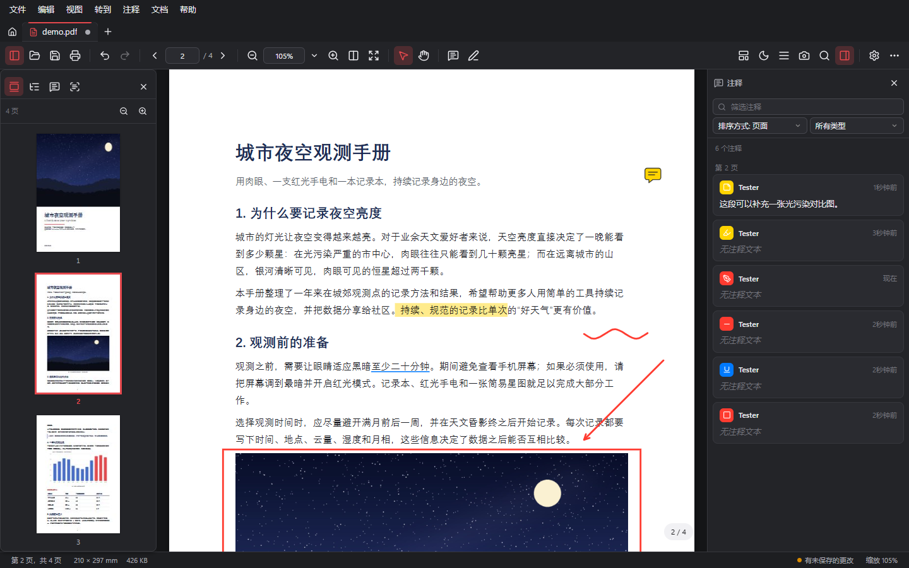<br>
  <sub>主界面（深色主题）：左侧是页面缩略图，右侧是批注列表，页面上有高亮、下划线、便笺、手绘、箭头和矩形批注</sub>
</p>

<table>
  <tr>
    <td width="50%">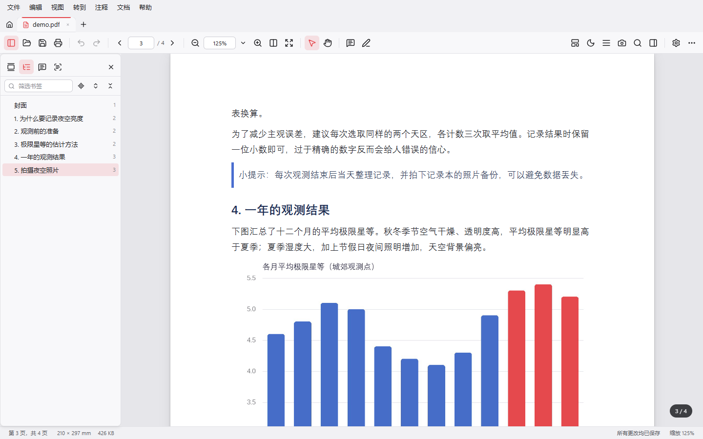<br><sub>浅色主题与书签目录</sub></td>
    <td width="50%">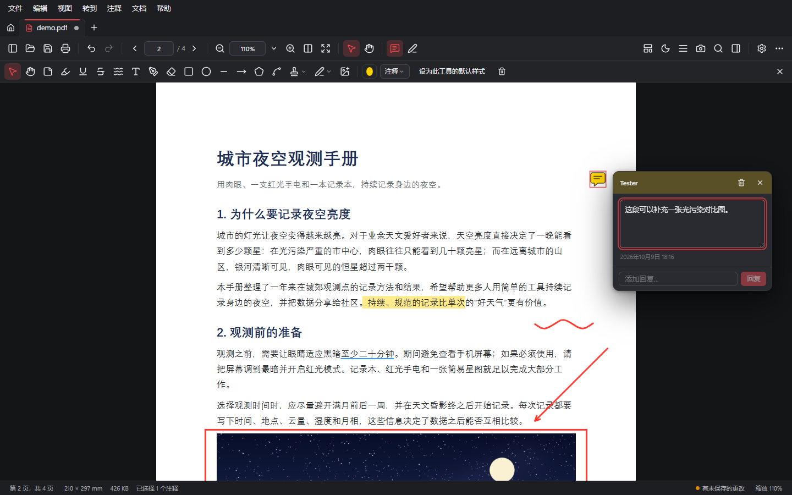<br><sub>批注工具栏、便笺与回复</sub></td>
  </tr>
  <tr>
    <td width="50%">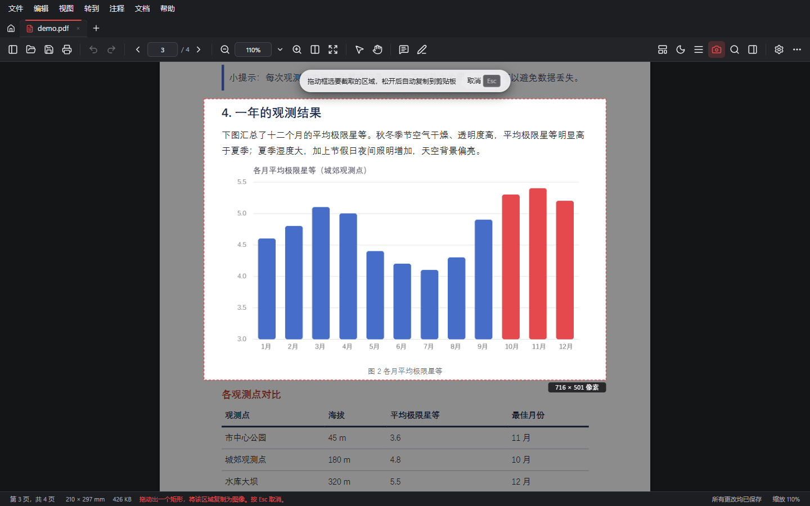<br><sub>框选截图：选区以外变暗，选区保持原亮度，并显示输出图片的尺寸</sub></td>
    <td width="50%">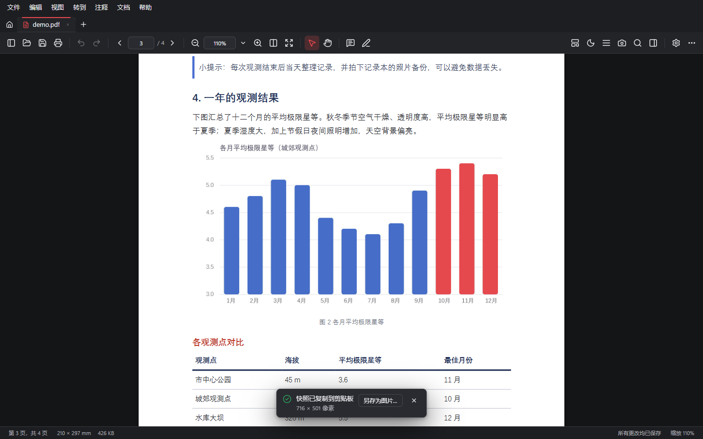<br><sub>松开鼠标即复制到剪贴板，自动退出截图模式；也可以另存为 PNG</sub></td>
  </tr>
  <tr>
    <td width="50%">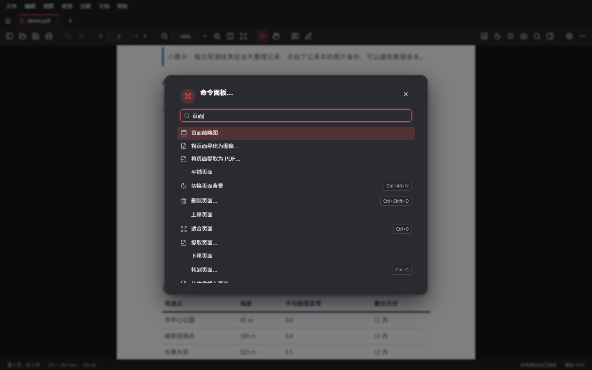<br><sub>命令面板：搜索并执行任意命令</sub></td>
    <td width="50%">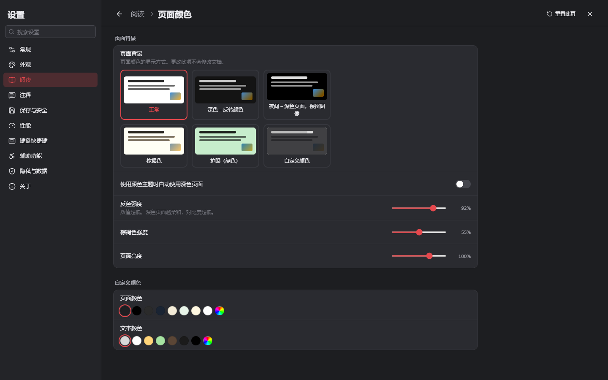<br><sub>分层设置页：支持搜索、单项重置和导入导出</sub></td>
  </tr>
</table>

**页面配色模式**：同一页文档在五种模式下的效果。注意「夜间」模式下页面变暗了，图片却保持原来的颜色。

<p align="center">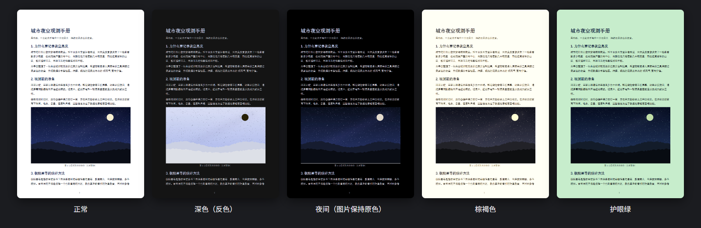</p>

<p align="center">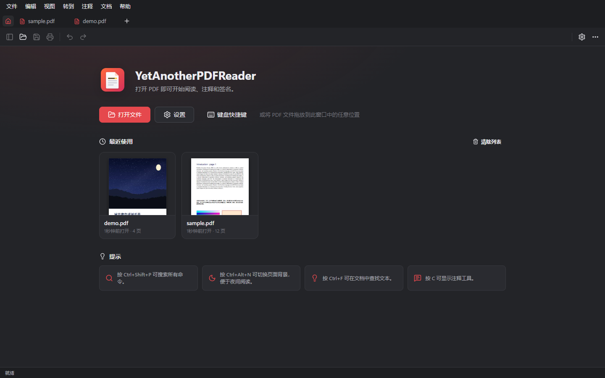<br><sub>起始页：带封面缩略图的最近文档</sub></p>

> 截图中的演示文档由 [`scripts/make-demo-pdf.py`](scripts/make-demo-pdf.py) 生成，截图由 [`scripts/readme-shots.mjs`](scripts/readme-shots.mjs) 自动拍摄。

---

## 📚 功能一览

### 阅读

| 功能 | 说明 |
| --- | --- |
| **多标签** | 拖动排序、中键关闭、重新打开已关闭的标签、启动时恢复上次的文档；再次打开同一个文件时会切换到已有标签 |
| **页面布局** | 单页、连续、双页（可带封面）、横向滚动、平铺 |
| **缩放** | 预设比例、适合页面、适合宽度、实际大小；Ctrl+滚轮和触控板双指缩放以鼠标位置为中心；旋转视图 |
| **侧栏** | 虚拟化的页面缩略图（可拖动重排页面）、书签（筛选、展开和折叠、跟随当前位置）、批注列表、附件、图层、全文搜索 |
| **查找** | 区分大小写、全字匹配、区分变音符号、高亮全部结果；按页码或页面标签跳转；前进和后退 |
| **链接与表单** | 文档内跳转；外部链接打开前可以确认；可填写的交互式表单 |
| **专注阅读** | 阅读模式、全屏、演示模式（切换动画、自动翻页、单击翻页）、自动滚动 |
| **页面配色** | 正常、深色、夜间（图片保持原色）、棕褐、护眼绿，以及自定义文字和背景颜色；可以跟随深色主题 |
| **框选截图** | Ctrl+Alt+S 或工具栏上的 📷 按钮。可选屏幕分辨率或 150 / 300 / 600 DPI，可选是否包含批注、是否套用页面配色 |
| **其他** | 朗读（系统语音）；打印（可选页面范围和质量）；把页面导出为图片或文本；文档属性（可修改标题、作者等，可查看安全设置和字体） |

### 批注与编辑

| 功能 | 说明 |
| --- | --- |
| **文本标记** | 高亮、下划线、删除线、波浪线；选中文字后会出现浮动工具栏 |
| **便笺与讨论** | 便笺支持回复和审阅状态；也可以添加文本框 |
| **绘图** | 手绘（自动平滑，相邻笔画自动合并）、橡皮擦、矩形、椭圆、直线、箭头、多边形、折线 |
| **图章与签名** | 标准图章、带姓名和日期的动态图章、自定义图章、图片图章；手写、键入或图片签名，可保存后重复使用 |
| **编辑批注** | 选择、移动、缩放、编辑顶点；修改颜色、不透明度、线宽、字体、线端样式；复制粘贴、锁定、设为工具默认样式。**新建的批注和文件中原有的批注都能编辑** |
| **页面整理** | 旋转、删除、插入空白页、从其他 PDF 插入页面、重排、提取为新文件 |
| **撤销与保存** | 所有操作（包括页面操作）都能撤销和重做；有未保存的修改时会提醒；保存、另存为、还原；崩溃恢复；可选备份 |

### 易用性

- 浅色、深色或跟随系统主题，可以调整强调色、界面密度、文字大小和动画
- **9 种界面语言**：简体中文、繁體中文、English、日本語、한국어、Deutsch、Français、Español、Русский
- 分层设置页，支持搜索、单项重置和导入导出
- 快捷键可以完全自定义，另有命令面板
- 文件关联；单实例运行（从资源管理器打开的文件会进入已打开的窗口）；拖放打开
- 文件被其他程序修改或删除时会提示

---

## 🆚 与其他阅读器对比

下表是作者整理的 Windows 上几款常见阅读器**免费版**的大致情况，仅供参考。这些软件更新很快，如有出入，欢迎在 Issue 中指正。

| | **YAPR** | Adobe Acrobat Reader | Foxit PDF Reader | SumatraPDF |
| --- | :-: | :-: | :-: | :-: |
| 开源 | ✅ MIT | ❌ | ❌ | ✅ GPLv3 |
| 安装包体积 | **约 5 MB** | 数百 MB | 约百 MB | 约 10 MB |
| 不需要账号，无推广，无遥测 | ✅ | ❌ | ❌ | ✅ |
| 多标签 | ✅ | ✅ | ✅ | ✅ |
| 完整批注（图形、图章、签名） | ✅ | ✅ | ✅ | 基础 |
| 修改文件中原有的批注 | ✅ | ✅ | ✅ | 部分 |
| 页面整理（插入、删除、重排、提取） | ✅ 免费 | 需付费版 | 视版本而定 | ❌ |
| 区域截图复制到剪贴板 | ✅ 可选 DPI | ✅ | ✅ | ✅ |
| 命令面板 | ✅ | ❌ | ❌ | ✅ |
| 便携版 | ✅ | ❌ | ❌ | ✅ |

**简单来说**：如果你只需要一个极简、极快的阅读器，SumatraPDF 是很好的选择；如果你想要接近 Acrobat 的批注和页面整理功能，但不想要几百 MB 的安装包、登录和推广，YAPR 就是为你准备的。

---

## ⚡ 常用快捷键

| 操作 | 快捷键 | 操作 | 快捷键 |
| --- | --- | --- | --- |
| 打开文件 | `Ctrl+O` | 命令面板 | `Ctrl+Shift+P` / `Ctrl+K` |
| 保存 / 另存为 | `Ctrl+S` / `Ctrl+Shift+S` | 查找 | `Ctrl+F` |
| 打印 | `Ctrl+P` | 转到页面 | `Ctrl+G` |
| 撤销 / 重做 | `Ctrl+Z` / `Ctrl+Y` | 适合页面 / 适合宽度 | `Ctrl+0` / `Ctrl+2` |
| 关闭标签 / 重新打开 | `Ctrl+W` / `Ctrl+Shift+T` | 放大 / 缩小 | `Ctrl+=` / `Ctrl+-` |
| 切换标签 | `Ctrl+Tab` | 显示或隐藏侧栏 | `F4` |
| 框选截图 | `Ctrl+Alt+S` | 切换页面配色 | `Ctrl+Alt+N` |
| 批注工具栏 | `C` | 选择 / 手形工具 | `V` / `H` |
| 阅读模式 | `Ctrl+H` | 演示模式 | `F5` / `Ctrl+L` |
| 全屏 | `F11` | 文档属性 | `Ctrl+D` |
| 设置 | `Ctrl+,` | 快捷键列表 | `Ctrl+/` |

所有快捷键都可以在「设置 ▸ 键盘快捷键」中修改。把鼠标悬停在批注工具栏的按钮上，可以看到各个工具的单键快捷键。

---

## 🧱 技术架构

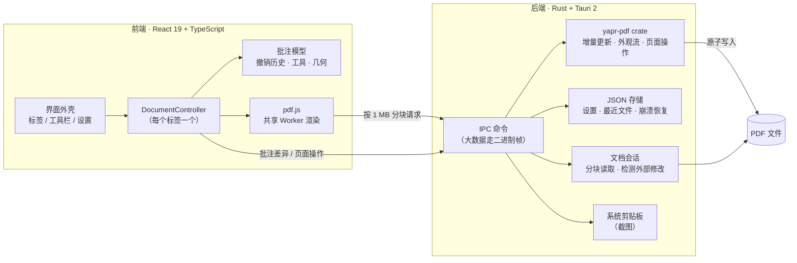

**保存流程**：每次保存只计算与原始文件的差异，再以增量更新的方式追加到文件末尾。

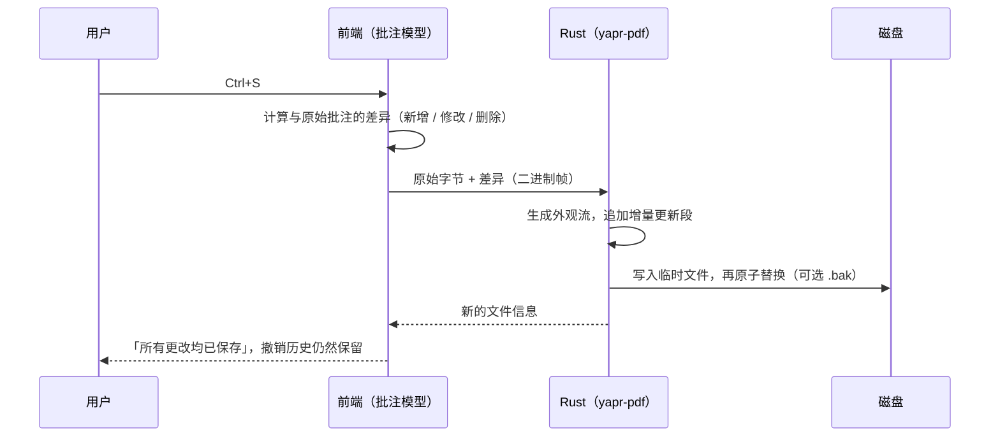

设计要点：

- **渲染**：pdf.js 在一个共享 Worker 中渲染。超过设定大小的文件按 1 MB 分块从磁盘读取；后台标签在一段时间后释放渲染缓存。
- **批注**：保存在内存模型中，文件里原有的批注由 Rust 核心读取。修改某条原有批注时，应用会隐藏 pdf.js 绘制的版本，改由自己绘制。
- **保存**：始终计算与原始字节的差异，由 Rust 以增量更新写入，原有内容不变，数字签名保持有效。
- **页面操作**：由 Rust 重建文档，并保留修改前的字节，所以可以撤销。
- **截图**：从 PDF 重新渲染选区，像素数据交给 Rust 写入系统剪贴板，避开了 WebView 剪贴板接口的权限限制。

<details>
<summary><b>目录结构</b></summary>

```
src/                     React + TypeScript 前端
  document/              DocumentController：pdf.js 视图、历史、保存流程、页面配色、打印、演示、朗读、搜索、缩略图、截图
  annotations/           批注模型、撤销历史、工具、几何计算、DTO、序列化
  components/            界面（外壳、阅读视图、批注叠加层、侧栏、对话框、设置）
  commands/              命令注册表和快捷键处理
  settings/              设置模型（带校验）和设置页结构
  i18n/                  多语言运行时和 9 种语言文件
  pdf/                   pdf.js 初始化（共享 Worker、分块读取）
src-tauri/               Tauri 应用外壳（Rust）
  session.rs             打开的文档、分块读取、检测外部修改
  commands.rs            IPC 命令（大数据走二进制帧）
  store.rs / fsutil.rs   防损坏的 JSON 存储和原子写入
  portable.rs            便携模式
crates/yapr-pdf/         PDF 写入核心（Rust，不依赖界面，有单元测试）
scripts/                 示例文档生成、端到端测试、界面冒烟测试、README 截图
```

</details>

---

## 🔧 从源码构建

**环境要求**：Rust（stable，Windows 上使用 MSVC 工具链）、Node.js 22 或更高版本、WebView2（Windows 10/11 已自带）。

```bash
git clone https://github.com/AlexEisie/YetAnotherPDFReader.git
cd YetAnotherPDFReader
npm install

npm run tauri dev        # 开发模式（Rust 后端 + Vite 热更新）
npm run tauri build      # 发布构建，生成 NSIS 安装包和 MSI
```

只在浏览器中调试界面（使用模拟的后端）：

```bash
python scripts/make-sample-pdfs.py   # 生成 dev/samples/ 下的示例文档（需要 PyMuPDF）
npm run dev                          # 打开 http://localhost:5174
```

**制作便携版**：把 `yapr.exe` 和一个名为 `portable`（或 `portable.txt`）的空文件放在同一个文件夹里。程序检测到这个文件后，会把所有数据保存到旁边的 `data` 文件夹。

### 测试

```bash
npm test                         # 前端单元测试（Vitest）
cargo test --workspace           # Rust 单元测试（PDF 写入核心、存储、IPC 帧）
cargo clippy --all-targets       # 静态检查
node scripts/e2e-tauri.mjs       # 端到端测试：驱动真实应用，校验写出的 PDF 和剪贴板内容
npm run test:ui                  # 界面冒烟测试，并保存截图
npm run test:release             # 发布版冒烟测试
```

---

## 📌 路线图

- [x] Windows 首个版本（安装版、MSI、便携版）
- [ ] 代码签名
- [ ] 应用内检查更新
- [ ] macOS / Linux 构建（代码本身是跨平台的，尚未测试和打包）
- [ ] 跨页截图、OCR、编辑 PDF 正文

欢迎在 [Issues](https://github.com/AlexEisie/YetAnotherPDFReader/issues) 中提出建议或反馈问题。

## 🤝 参与贡献

欢迎提交 Issue 和 Pull Request。提交代码前，请确认 `npm test`、`cargo test --workspace` 和 `cargo clippy --all-targets` 都能通过。如果改动涉及界面文字，请同时更新 `src/i18n/locales/` 下的 9 个语言文件。

## 📄 开源协议

本项目使用 [MIT License](LICENSE)。第三方组件（pdf.js、Tauri、React、lopdf 等）的许可信息见 [THIRD-PARTY-NOTICES.md](THIRD-PARTY-NOTICES.md)。

## 🙏 致谢

- [pdf.js](https://github.com/mozilla/pdf.js)：PDF 渲染引擎
- [Tauri](https://tauri.app/)：轻量的桌面应用框架
- [lopdf](https://github.com/J-F-Liu/lopdf)：Rust PDF 读写库
- [React](https://react.dev/)、[Zustand](https://github.com/pmndrs/zustand)、[Lucide](https://lucide.dev/)、[arboard](https://github.com/1Password/arboard)

<p align="center">如果这个项目对你有帮助，欢迎点一个 ⭐ Star！</p>
